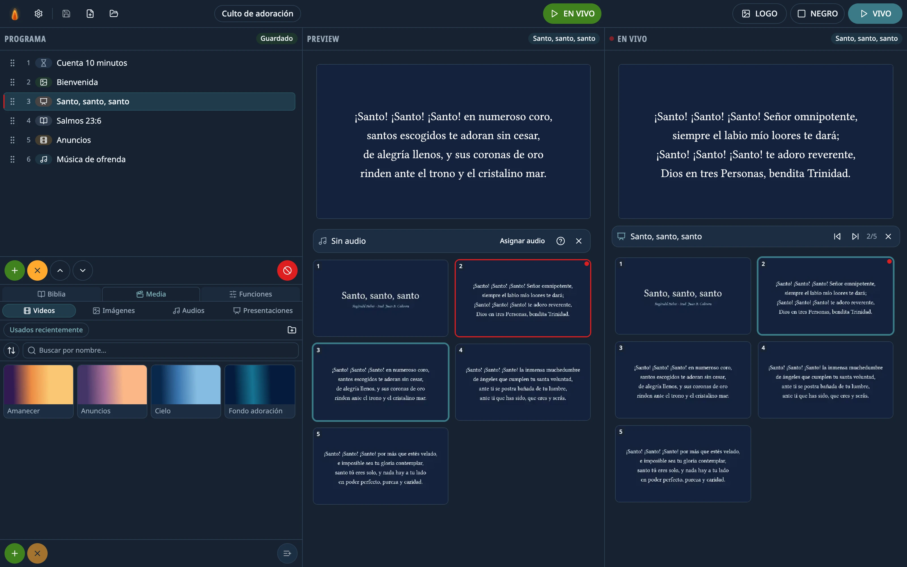

# Lumina Live

**Free and open-source church presentation software.** Slides, video, images, audio, the Bible and
timers on a second screen, with the same two-step flow as EasyWorship: pick it, check the preview,
and only then send it LIVE.

**[Website](https://lumina-live-site.vercel.app/)** · **[Download](https://github.com/NicolasAmorosi/lumina-live/releases/latest)** ·
Windows, macOS and Linux · English, Spanish, Italian and Portuguese



## Features

- **Presentations** in `.ppt`, `.pptx`, `.pps`, `.ppsx`, `.odp` and `.pdf`, including `.pps` hymnals
  with auto-advance and music: each slide's timing and the embedded audio are kept.
- **Any video or audio.** Whatever the player can't decode (AVI, WMV, ProRes, AC3…) is converted in
  the background with FFmpeg, which comes bundled. The original file is never touched.
- **Bible** with full-text search (accent-insensitive). Ships with the Reina-Valera 1909; import other
  versions in JSON, Zefania, USFX, OSIS or MyBible/MySword modules.
- **Timers** (countdown, clock, stopwatch) and **overlays** on top of what is projected (a lower third
  with the preacher's name, the church logo).
- **BLACK and LOGO** pause whatever is playing and resume it where it was.
- **Built for a live service:** if the projector disconnects, the picture comes back by itself when
  it reconnects; the schedule saves itself; closing the app by accident asks first.
- Saved programs, a media library, light and dark themes.
- **In English, Spanish, Italian and Portuguese.** The first launch follows the computer's language;
  change it in Settings › System.

## Download

Installers are on [Releases](https://github.com/NicolasAmorosi/lumina-live/releases/latest): Windows
(installer), macOS on Apple Silicon (`.dmg`) and Linux: a `.deb` for Ubuntu, Debian and Linux Mint,
and an `AppImage` for other distributions. On Ubuntu 24.04 or later use the `.deb`: AppArmor won't
let the AppImage start without `--no-sandbox`, which turns off a security protection.

**On Linux, Lumina Live is still experimental.** In automated testing the projection and control
windows closed by themselves while a presentation was on screen, which doesn't happen on Windows or
macOS. Test it thoroughly before relying on it in a service.

- **LibreOffice** is needed for PowerPoint presentations, except PDFs and old `.ppt`/`.pps` decks made
  only of pictures — like most hymnals — which open instantly without it. If it isn't installed, the
  app detects it and explains how to install it.
- The installers **aren't signed yet**. On Windows: «More info» → «Run anyway». On macOS: System
  Settings → Privacy & Security → «Open Anyway».

## Development

Requires Node.js 22 or later.

```bash
npm install          # also downloads Electron and the FFmpeg for your platform
npm run dev          # the app with hot reload
npm run typecheck && npm run lint && npm run test   # the minimum before a PR
npm run test:e2e     # end-to-end runs of the real app with Playwright
npm run package:win  # or package:mac / package:linux
```

Before touching code, read [`CLAUDE.md`](CLAUDE.md): it is the project's architecture and conventions
guide, and [`docs/knowledge/`](docs/knowledge/) has the detail of each layer. To contribute, see
[`CONTRIBUTING.md`](CONTRIBUTING.md).

Stack: Electron, TypeScript, React, Vite, Tailwind, Zustand and SQLite (`better-sqlite3` + Drizzle).

## License

[GPL-3.0-or-later](LICENSE). You can use, study, modify and share it; if you distribute a modified
version, it has to stay free under the same license.

FFmpeg ships alongside the app as a separate program, under its own GPL-3.0 license (see
[`resources/ffmpeg-NOTICE.txt`](resources/ffmpeg-NOTICE.txt)). The text of the Reina-Valera 1909 is
in the public domain.
